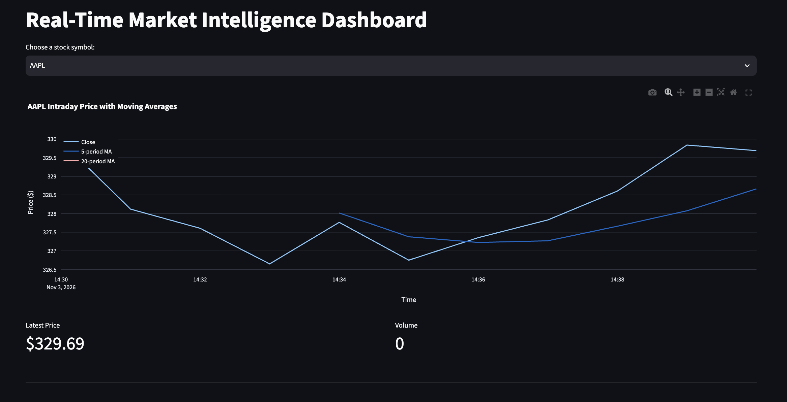
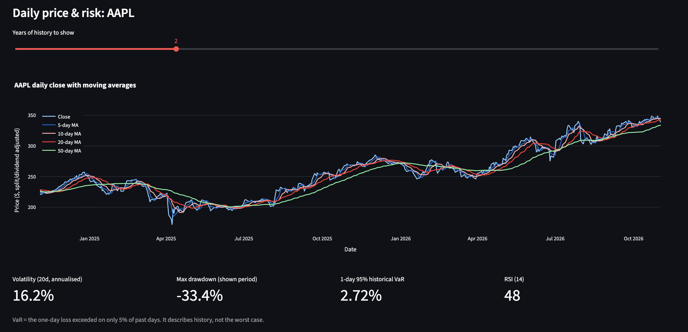
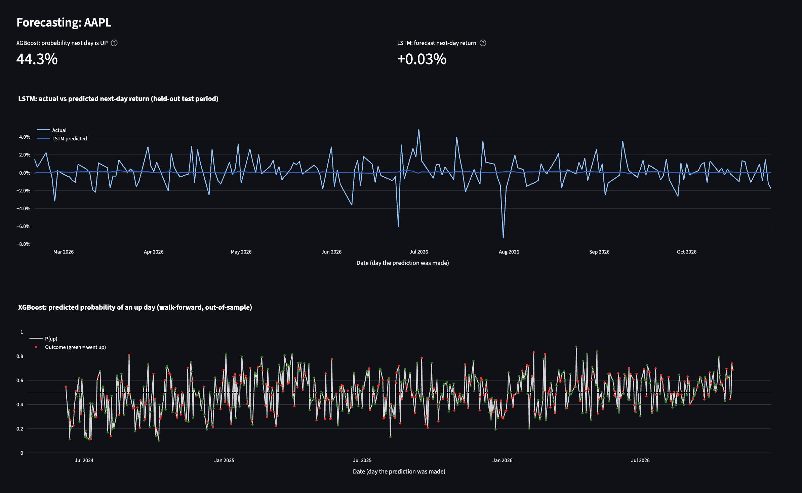
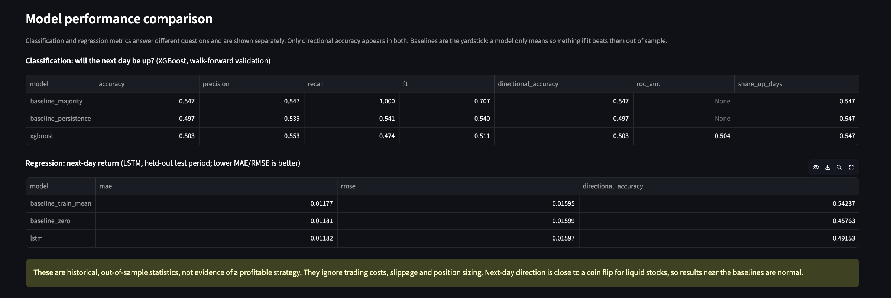

# Real-Time Market Intelligence Dashboard: forecasting & risk analytics

An end-to-end financial data science project: market data pipeline → PostgreSQL → leak-free
feature engineering → two forecasting models (XGBoost, PyTorch LSTM) → Streamlit dashboard with
risk indicators, model comparison and news sentiment.

*Live intraday price (1-minute bars) with 5- and 20-period moving averages.*


*Daily price with moving averages and risk indicators: volatility, max drawdown, historical VaR, RSI.*


*XGBoost probability of an up day and LSTM next-day return, with out-of-sample predictions against actuals.*


*Both models scored against naive baselines. Results are close to the baselines, as expected for next-day direction.*
Tickers: AAPL, MSFT, TSLA, NVDA.

> **Honest scope note.** Next-day stock direction is very hard to predict. This project is built to
> show correct methodology (no look-ahead leakage, chronological validation, baselines, honest
> metrics), not to claim a profitable trading signal. Results near the baselines are expected.
> No performance numbers are quoted here: run the pipeline yourself and report what you get.

## What it does

| Layer | What | Where |
|---|---|---|
| Intraday collector | 1-minute bars for the live chart | `etl_yfinance.py` |
| Historical pipeline | Several years of daily OHLCV, cleaned, validated, idempotent upsert | `src/data_pipeline.py` |
| Features | Returns, lagged returns, MA 5/10/20/50, rolling volatility, RSI, MACD, volume change | `src/features.py` |
| XGBoost | Classifier: is the next day's return positive? Walk-forward validation | `src/train_xgb.py` |
| LSTM | PyTorch regressor: next-day return from the previous 30 days | `src/train_lstm.py` |
| Metrics / risk | Shared metrics; volatility, max drawdown, historical VaR | `src/metrics.py`, `src/risk.py` |
| Dashboard | Charts, risk, forecasts, model comparison, feature importance, news sentiment | `app.py` |
| Storage | `market_data`, `daily_prices`, `model_results`, `predictions`, `feature_importance` | `sql/schema.sql` |

## Architecture and data flow

```
yfinance ──► etl_yfinance.py ───────────► market_data (1-min bars) ─┐
yfinance ──► src/data_pipeline.py ──────► daily_prices ─────────────┤
                                              │                     │
                                   src/features.py                  │
                                     │              │               ▼
                              src/train_xgb.py  src/train_lstm.py  app.py (Streamlit)
                                     └──────┬───────┘               ▲
                                            ▼                       │
                       model_results / predictions / feature_importance ┘
NewsAPI ──► TextBlob sentiment ───────────────────────────────────► app.py
```

## Setup (macOS)

Requires Python 3.11+ and Homebrew.

```bash
# 1. Get the code
git clone https://github.com/manideepasanyal/Trading-dashboard.git
cd Trading-dashboard
git checkout feature/forecasting          # until it is merged into main

# 2. PostgreSQL
brew install postgresql@16
brew services start postgresql@16
"$(brew --prefix postgresql@16)/bin/createdb" marketdb

# 3. Python environment
python3 -m venv venv
source venv/bin/activate
pip install -r requirements.txt           # torch is large; the first install takes a while

# 4. Secrets (never committed: .streamlit/secrets.toml is in .gitignore)
cp .streamlit/secrets.toml.example .streamlit/secrets.toml
#    then edit it: set DATABASE_URL (default local value works if your DB user is your Mac login)
#    and NEWS_API_KEY from https://newsapi.org (free tier is enough; optional)
```

`DATABASE_URL` for a default Homebrew install is normally
`postgresql+psycopg2://localhost:5432/marketdb`. Environment variables of the same names override
the file. **Never commit real credentials.**

## Run it

```bash
python -m src.data_pipeline     # 5 years of daily data for all four tickers (safe to re-run)
python -m src.train_xgb         # walk-forward XGBoost, prints metrics, saves results
python -m src.train_lstm        # LSTM, prints MAE / RMSE, saves results
python etl_yfinance.py          # optional: today's 1-minute bars for the intraday chart
streamlit run app.py            # dashboard at http://localhost:8501
```

Useful options: `--symbols AAPL MSFT`, `--years 8` (pipeline), `--folds 6` (XGBoost),
`--epochs 60` (LSTM). After retraining, press **Refresh data** in the dashboard sidebar.

## Tests

```bash
pytest -q
```

The suite uses **synthetic random-walk prices** (`tests/synthetic.py`) so it needs no network.
These tests check mechanics, not market performance. Two tests need a database:

- `DATABASE_URL`: the idempotency and save-results tests (they use throwaway `ZZ…` symbols and clean up).
- `TEST_DATABASE_URL`: the dashboard render test. **Point this at a scratch database, not your real
  one**: it deletes AAPL rows. If unset, that test is skipped.

## Design decisions (and why)

**Preventing data leakage**
- Every feature in row *t* uses only data up to the close of day *t*; rolling and exponential
  windows are backward-looking. A test proves it: features at day *t* are identical whether or not
  later data exists, and the same test fails on a deliberately leaky feature.
- The only forward-looking columns are the targets (`target_return`, `target_up`), kept out of the
  model inputs.
- Moving averages enter the models as ratios (`close / MA − 1`) and MACD is divided by price, so
  features are comparable across years and across stocks instead of tracking the price level.

**Validation**
- XGBoost uses expanding-window **walk-forward validation**: train on the past, predict the next
  block, move forward. Every prediction comes from a model that never saw that day.
- The LSTM uses a chronological 70/15/15 train/validation/test split. The scaler and target scale
  are fit on training rows only; the validation set drives early stopping; the test set is used
  once. A test confirms the scaler does not change when data after the training period changes.
- Both are compared with simple baselines. A model that does not beat them out of sample has
  learned nothing useful. Sensitivity tests feed each model tomorrow's return as an input and
  check that it is detected: this confirms the evaluation can actually catch leakage.

**Metrics**
- Classification (XGBoost): accuracy, precision, recall, F1, directional accuracy, ROC-AUC.
  Baselines: always-majority-direction and "tomorrow = today".
- Regression (LSTM): MAE, RMSE, directional accuracy. Baselines: predict zero, predict the
  training mean.
- The two families are shown separately in the dashboard. Directional accuracy is the only metric
  both can be scored on. For the classifier it equals plain accuracy, because the label is
  "return > 0".

**Data engineering**
- `daily_prices` has `PRIMARY KEY (symbol, date)` and writes use `INSERT … ON CONFLICT DO UPDATE`,
  so re-running never duplicates rows. Daily rows are *updated* (not skipped) because Yahoo
  restates split/dividend-adjusted history. Intraday bars are immutable, so they use `DO NOTHING`.
- Prices are `auto_adjust=True`, so a stock split does not appear as a −50% day.
- Cleaning drops missing values, duplicate dates and invalid prices (non-positive, high < low) and
  warns on suspicious one-day moves above 40%.
- One failing ticker does not stop the others.

**Models**
- Deliberately small: depth-3 trees (XGBoost) and one 32-unit LSTM layer with dropout. Daily
  returns are mostly noise, and a larger model mostly memorises it. Hyperparameters are fixed and
  were not tuned on the test folds.

**Risk indicators** (computed from past data only): 20-day annualised volatility (daily std × √252),
maximum drawdown, 1-day 95% historical VaR (the loss exceeded on 5% of past days; a description of
history, not a forecast or a worst case), and RSI(14).

## Known limitations

- No transaction costs, slippage or position sizing: nothing here is a trading strategy.
- Single-stock models with ~5 years of data (about 1,250 daily rows per ticker): small samples.
- The test period is one slice of market history; results may not carry over to other regimes.
- Walk-forward folds are not independent, so fold-to-fold spread is only a rough guide.
- News sentiment (TextBlob on headlines) is a simple lexicon score, shown for context and not used
  by the models.
- Yahoo Finance is an unofficial data source and can change or rate-limit without notice.

## Project layout

```
app.py                         Streamlit dashboard
etl_yfinance.py                1-minute collector for the intraday chart
src/config.py                  symbols and secret loading (env vars, then .streamlit/secrets.toml)
src/db.py                      engine, schema creation, idempotent upsert
src/data_pipeline.py           daily history download, cleaning, storage
src/features.py                leak-free feature engineering
src/metrics.py  src/risk.py    evaluation metrics and risk indicators
src/train_xgb.py               XGBoost classifier, walk-forward validation
src/train_lstm.py              PyTorch LSTM regressor
sql/schema.sql                 PostgreSQL schema
tests/                         pytest suite (synthetic data)
.streamlit/secrets.toml.example
```

## License

MIT
